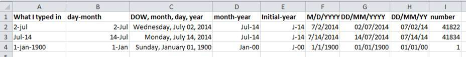

::::::::::::::::::::::::::::::::::::::: objectives

- Describe how spreadsheets store and display dates.
- Record dates in a form that no program can misread.

::::::::::::::::::::::::::::::::::::::::::::::::::

:::::::::::::::::::::::::::::::::::::::: questions

- Why do dates cause so many errors?
- How should I record dates and times?

::::::::::::::::::::::::::::::::::::::::::::::::::

## What day is 04/02/2024?

Cell A9 of Sipho's tab reads `04/02/2024`. In South Africa and most of the
world that is 4 February. In the United States it is 2 April. The sampling
schedule says weekly from 5 March, so it must be 2 April, but the cell does
not say so, and neither a script nor an AI tool will check the schedule.

Column A of the same tab holds five formats for one kind of value:

| Cell | As typed | Problem |
| --- | --- | --- |
| A5 | a real spreadsheet date | Fine inside Excel; shown differently on other computers |
| A6 | `12 Mar` | No year; Excel silently adds the *current* year |
| A7 | `2024/03/19` | Text, not a date |
| A8 | `26-03-2024` | Text, day first |
| A9 | `04/02/2024` | Text, month first: ambiguous |

## How spreadsheets store dates

Excel stores a date as a number: the count of days since 31 December 1899
(so 2 July 2014 is 41822). What you see depends on the computer's regional
settings, not on the data. Three consequences follow:

- The same file can show different dates on two computers.
- Excel on older Macs used a 1904 date system; dates moved between systems
  can shift by about four years.
- Excel converts things that are not dates into dates. Gene names such as
  MAR1 and sample codes such as `12-3` become dates, and the original text
  cannot be recovered.

{alt='Many date formats in Excel, each displaying the same stored number differently'}

## Record dates unambiguously

Use one of these, and say which in your data dictionary:

1. **ISO 8601: `YYYY-MM-DD`**, for example `2024-04-02`. It sorts
   correctly, every analysis tool reads it, and it is unambiguous worldwide.
   This is the default for this lesson.
2. **Separate columns** for year, month and day.
3. **Year and day of year** (`2024`, `93`), useful for seasonal analysis.

For date and time together, use `YYYY-MM-DDThh:mm`, for example
`2024-04-02T09:15`, and state the time zone (SAST, UTC+2) in the data
dictionary.

To stop Excel converting a typed ISO date into its own format, format the
column as **Text** before you enter data, or type the dates in a CSV file.

::::::::::::::::::::::::::::::::::::::: challenge

## Exercise: what happens on export?

Copy Sipho's North Beach block to a new tab. Save that tab as
`CSV UTF-8` and open the CSV in a plain text editor (Notepad, TextEdit).
Then open the CSV again in Excel.

How do the dates in cells A5 and A6 change at each step?

:::::::::::::::: solution

## Solution

The real date in A5 is written out in whatever format your computer's
regional settings use. The text `12 Mar` may be turned into a date in the
current year when the CSV is reopened. Each round trip through Excel can
change the data. ISO dates stored as text survive unchanged.

:::::::::::::::::::::::::

::::::::::::::::::::::::::::::::::::::::::::::::::

:::::::::::::::::::::::::::::::::::::::: keypoints

- Spreadsheets store dates as numbers and display them according to local settings.
- Record dates as ISO 8601 text, `YYYY-MM-DD`, or as separate year, month and day columns.
- Check every date after moving data between programs or computers.

::::::::::::::::::::::::::::::::::::::::::::::::::
