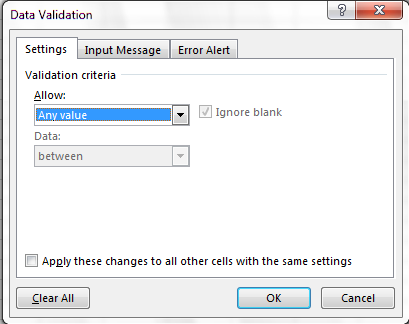
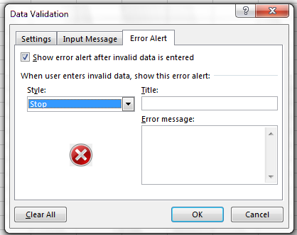
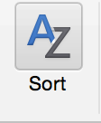

::::::::::::::::::::::::::::::::::::::: objectives

- Use data validation to prevent invalid entries.
- Use sorting and conditional formatting to find errors.

::::::::::::::::::::::::::::::::::::::::::::::::::

:::::::::::::::::::::::::::::::::::::::: questions

- How do I stop bad data getting in, and find the bad data already there?

::::::::::::::::::::::::::::::::::::::::::::::::::

Quality **assurance** stops bad data being entered. Quality **control**
finds errors after entry. Prevention is cheaper: thirteen spellings of four
beaches take minutes to clean and seconds to prevent.

## Quality assurance: data validation

Data validation (Excel) or Validity (LibreOffice Calc) restricts what a
column accepts.

Set the `site` column to accept only the four beaches:

1. Select the `site` column.
2. **Data > Data Validation** (Excel) or **Data > Validity** (Calc).
3. In **Allow**, choose **List**.
4. In **Source**, type `North Beach,Addington,uShaka,Umhlanga Main`.
5. Try typing `Umhlanga Rocks`. The spreadsheet refuses it.

{alt='Data Validation window in Excel'}

A list also gives a drop-down, so nobody needs to remember the spelling.
Use the same tool for numbers: Enterococci counts must be whole numbers of
zero or more; water temperature in Durban should fall between, say, 10 and
35 °C. A Fahrenheit value such as 74.1 is then rejected at entry.

On the **Error Alert** tab you can change a hard stop into a warning, for
values that are unusual but possible.

{alt='Error Alert tab of the Data Validation window'}

## Quality control: finding errors

**Before you start, save the original file and work on a copy.** Make sure
the copy holds values, not formulas, so that moving cells cannot change
results.

### Sort each column

Bad values collect at the top or bottom of a sorted column. Sort the count
column from largest to smallest: text such as `55 cfu`, `<10` and `TNTC`
gathers at one end, blanks at the other, and `-999` at the bottom of the
numbers.

{alt='Sort button on the Data tab in Excel'}

When Excel asks, choose **Expand the selection**. Sorting one column on its
own scrambles your rows: each value moves away from the sample it belongs
to.

### Conditional formatting, with care

A colour scale on the count column (Home > Conditional Formatting > Color
Scales) shows outliers at a glance, and leaves text cells uncoloured. Use it
to *find* problems while checking. Never use colour to *record*
information.

### Count the categories

Select the `site` column and use **Data > Filter**. The filter drop-down
lists every distinct value in the column. Four beaches should give four
entries; Lerato's tab gives thirteen.

::::::::::::::::::::::::::::::::::::::::: callout

## Keep a log

As you clean, write each step in a plain-text file kept with the data:
what you changed, why, and when. If an AI tool did the cleaning, record the
tool, the date and the prompt. See [episode 7](07-project-organisation.md).

::::::::::::::::::::::::::::::::::::::::::::::::::

:::::::::::::::::::::::::::::::::::::::: keypoints

- Always work on a copy of the raw data.
- Use data validation to prevent invalid entries and inconsistent categories.
- Sort, filter and colour-scale columns to find errors.
- Sort whole rows, never a single column.

::::::::::::::::::::::::::::::::::::::::::::::::::
